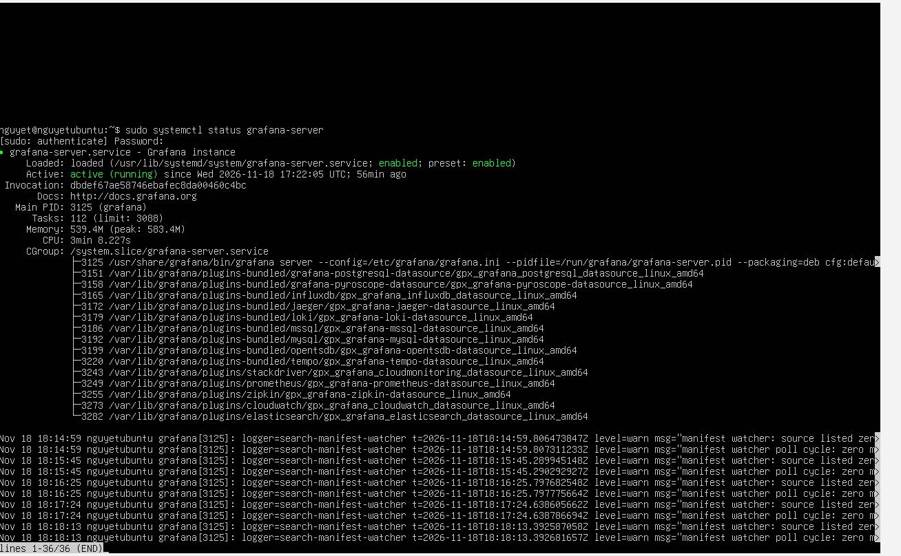

# N3-3B – Cài đặt Grafana và kiểm tra khả năng truy cập

| Thông tin | Chi tiết |
|---|---|
| Jira Issue | SCRUM-17 (thuộc SCRUM-11) |
| Nhóm thực hiện | N3-3B |
| Người thực hiện | Ánh Nguyệt |
| Ngày thực hiện | 18/11/2026 – 19/11/2026 |
| Hạn hoàn thành | 21/11/2026 |
| Công cụ trực quan hóa | Grafana v13.3.1 (da3aa3ff57) |
| Trạng thái | Đã cài đặt, truy cập Web UI thành công; kết nối Data source Prometheus đang thực hiện |

## 1. Mục tiêu

Cài đặt và khởi chạy Grafana, đảm bảo giao diện Web có thể mở và truy cập được từ máy tính cá nhân, kết nối được với Prometheus đã triển khai ở SCRUM-12.

**Kết quả cần đạt:** Truy cập được giao diện Grafana từ máy tính cá nhân, đăng nhập thành công và Data source Prometheus hoạt động, có ảnh chụp minh chứng.

## 2. Môi trường triển khai

| Thành phần | Thông tin |
|---|---|
| Hệ điều hành máy host | Windows 11 |
| Phần mềm máy ảo | Oracle VirtualBox |
| Hệ điều hành máy ảo | Ubuntu Server (hostname `nguyetubuntu`) |
| Grafana | v13.3.1 – cài từ gói `.deb` (APT) |
| Prometheus | 3.16.0 (SCRUM-12) |
| Truy cập từ máy host | `http://localhost:3000` |
| Giao thức truy cập | HTTP |
| Cổng dịch vụ | 3000 |

## 3. Quá trình cài đặt

### 3.1. Chuẩn bị môi trường

- Sử dụng máy ảo Ubuntu Server trên VirtualBox.
- Cập nhật danh sách gói:

```bash
sudo apt-get update
```

### 3.2. Cài đặt Grafana

Cài đặt Grafana OSS từ APT repository chính thức của Grafana:

```bash
sudo apt-get install -y apt-transport-https software-properties-common wget
sudo mkdir -p /etc/apt/keyrings/
wget -q -O - https://apt.grafana.com/gpg.key | gpg --dearmor | sudo tee /etc/apt/keyrings/grafana.gpg > /dev/null
echo "deb [signed-by=/etc/apt/keyrings/grafana.gpg] https://apt.grafana.com stable main" | sudo tee /etc/apt/sources.list.d/grafana.list
sudo apt-get update
sudo apt-get install -y grafana
```

**Kết quả thực tế:** Grafana được cài đặt dưới dạng gói `deb` (`--packaging=deb`), phiên bản **v13.3.1 (da3aa3ff57)** – hiển thị ở chân trang đăng nhập.

### 3.3. Khởi động service `grafana-server`

Gói cài đặt đã tạo sẵn systemd service `grafana-server`. Nạp lại cấu hình systemd, bật tự khởi động cùng hệ thống và khởi chạy dịch vụ:

```bash
sudo systemctl daemon-reload
sudo systemctl enable grafana-server
sudo systemctl start grafana-server
```

### 3.4. Cấu hình mạng VirtualBox

Để máy tính cá nhân truy cập được Grafana qua port 3000, cấu hình **NAT + Port Forwarding** trong VirtualBox: **Settings → Network → Adapter 1 → Advanced → Port Forwarding**, thêm rule:

| Name | Protocol | Host Port | Guest Port |
|---|---|---|---|
| grafana | TCP | 3000 | 3000 |

Khi đó truy cập `http://localhost:3000` từ trình duyệt trên Windows host.

> Phương án thay thế: dùng **Bridged Adapter** (giống SCRUM-12) và truy cập `http://<IP-máy-ảo>:3000`.

Nếu máy ảo bật tường lửa UFW:

```bash
sudo ufw allow 3000/tcp
```

## 4. Kiểm tra hoạt động

### 4.1. Kiểm tra trạng thái dịch vụ

```bash
sudo systemctl status grafana-server
```

**Kết quả thực tế:**

- `Loaded: loaded (/usr/lib/systemd/system/grafana-server.service; enabled; preset: enabled)` → dịch vụ đã được bật tự khởi động cùng hệ thống.
- `Active: active (running) since Wed 2026-11-18 17:22:05 UTC` → dịch vụ đang chạy ổn định.
- Tiến trình chính: `/usr/share/grafana/bin/grafana server --config=/etc/grafana/grafana.ini`.
- Plugin Data source Prometheus (`gpx_grafana-prometheus-datasource`) đã được nạp.



### 4.2. Kiểm tra cổng dịch vụ

```bash
ss -lntp | grep 3000
```

**Kết quả thực tế:** Giao diện Grafana phản hồi tại `localhost:3000` từ máy host (mục 4.3), xác nhận Grafana đang lắng nghe trên cổng TCP 3000.

### 4.3. Truy cập giao diện Web và đăng nhập lần đầu

Truy cập từ trình duyệt trên máy tính cá nhân: `http://localhost:3000`

- Trang đăng nhập **Welcome to Grafana** hiển thị thành công.
- Đăng nhập lần đầu bằng tài khoản mặc định, sau đó đổi mật khẩu mặc định theo yêu cầu của Grafana.
- **Mật khẩu mới không được ghi vào repository**; chỉ chia sẻ nội bộ qua kênh riêng của nhóm.


**Kết quả thực tế:** Đăng nhập thành công, trang chủ Grafana hiển thị *"Welcome to Grafana"*, menu **Connections → Data sources** sẵn sàng để cấu hình.


### 4.4. Thêm Prometheus làm Data source

Tại giao diện Grafana:

1. Vào **Connections → Data sources → Add data source**.
2. Chọn **Prometheus**.
3. Tại mục **Connection → Prometheus server URL**, nhập `http://localhost:9090` (Prometheus cài cùng máy ảo) hoặc `http://<IP-Prometheus>:9090`.
4. Bấm **Save & test**.

Ngoài cách thao tác thủ công, cấu hình Data source được lưu dưới dạng provisioning tại [`monitoring/grafana/provisioning/datasources/prometheus.yml`](../../monitoring/grafana/provisioning/datasources/prometheus.yml). Có thể áp dụng trên máy ảo:

```bash
sudo cp monitoring/grafana/provisioning/datasources/prometheus.yml /etc/grafana/provisioning/datasources/
sudo systemctl restart grafana-server
```

**Kết quả thực tế:** TODO (kỳ vọng thông báo `Successfully queried the Prometheus API.`)

<!--  -->

### 4.5. Truy vấn thử metrics qua Grafana

Vào **Explore**, chọn Data source Prometheus và chạy truy vấn:

```promql
up
```

**Kết quả thực tế:** TODO (kỳ vọng trả về giá trị `1` cho `job="prometheus"`)

<!--  -->

## 5. Tổng kết kết quả

| STT | Hạng mục kiểm tra | Kết quả |
|---:|---|---|
| 1 | Cài đặt Grafana v13.3.1 | Thành công |
| 2 | Service `grafana-server` ở trạng thái `active (running)` | Đạt |
| 3 | Thiết lập tự khởi động cùng hệ thống (`enabled`) | Đạt |
| 4 | Cổng TCP 3000 phản hồi | Đạt |
| 5 | Cấu hình mạng VirtualBox cho port 3000 | Đạt |
| 6 | Truy cập Web UI từ máy tính cá nhân (`localhost:3000`) | Đạt |
| 7 | Đăng nhập lần đầu và đổi mật khẩu mặc định | Đạt |
| 8 | Data source Prometheus – "Save & test" thành công | Chưa xác nhận |
| 9 | Truy vấn `up` trong Explore trả về `1` | Chưa xác nhận |

## 6. Các đường dẫn quan trọng

| Thành phần | Đường dẫn |
|---|---|
| Grafana binary | `/usr/share/grafana/bin/grafana` |
| File cấu hình | `/etc/grafana/grafana.ini` |
| Thư mục dữ liệu & plugin | `/var/lib/grafana/` |
| Thư mục log | `/var/log/grafana/` |
| PID file | `/run/grafana/grafana-server.pid` |
| Systemd service | `/usr/lib/systemd/system/grafana-server.service` |
| Provisioning Data source (máy ảo) | `/etc/grafana/provisioning/datasources/prometheus.yml` |
| Provisioning Data source (repository) | `monitoring/grafana/provisioning/datasources/prometheus.yml` |

## 7. Các lệnh quản trị thường dùng

**Kiểm tra trạng thái:**

```bash
sudo systemctl status grafana-server
```

**Khởi động dịch vụ:**

```bash
sudo systemctl start grafana-server
```

**Dừng dịch vụ:**

```bash
sudo systemctl stop grafana-server
```

**Khởi động lại dịch vụ:**

```bash
sudo systemctl restart grafana-server
```

**Theo dõi log:**

```bash
sudo journalctl -u grafana-server -f
```

## 8. Minh chứng

Các ảnh minh chứng được lưu trong thư mục `monitoring/evidence/` của repository:

| Tên file | Nội dung |
|---|---|
| `grafana-active.png` | Trạng thái systemd service `grafana-server` – `active (running)`, `enabled` |
| `grafana-login.png` | Trang đăng nhập Grafana v13.3.1 tại `localhost:3000` |
| `grafana-login-form.png` | Form đăng nhập Grafana (ảnh cận cảnh) |
| `grafana-ui.png` | Trang chủ Grafana sau khi đăng nhập |
| `grafana-datasource.png` | Kết quả "Save & test" Data source Prometheus (chưa bổ sung) |
| `grafana-explore-up.png` | Kết quả truy vấn `up` trong Explore (chưa bổ sung) |

## 9. Kết luận

Đã hoàn thành việc cài đặt Grafana v13.3.1 trên máy ảo Ubuntu Server, dịch vụ `grafana-server` chạy ổn định ở trạng thái `active (running)` và được bật tự khởi động cùng hệ thống.

Giao diện Grafana truy cập được từ máy tính cá nhân qua `http://localhost:3000`, đăng nhập thành công. Bước kết nối Data source Prometheus và truy vấn kiểm tra metrics sẽ được bổ sung minh chứng ở lần cập nhật tiếp theo.

Kết quả triển khai được ghi nhận để phục vụ Jira Issue **SCRUM-17** trong dự án HKDN Monitoring.
