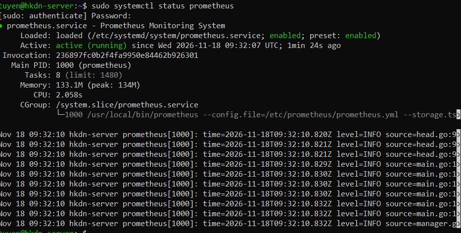
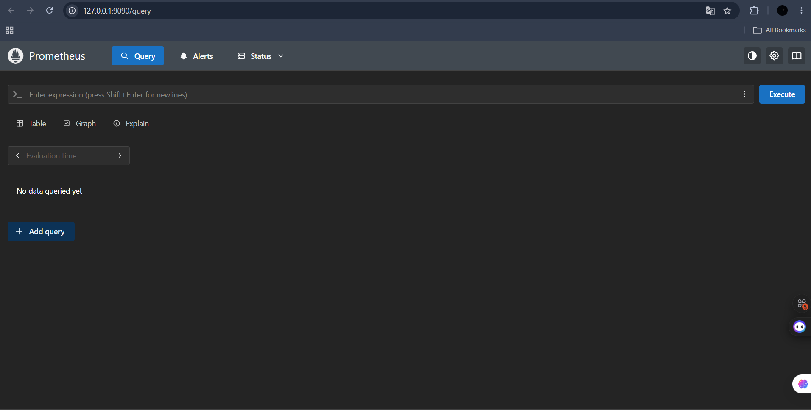
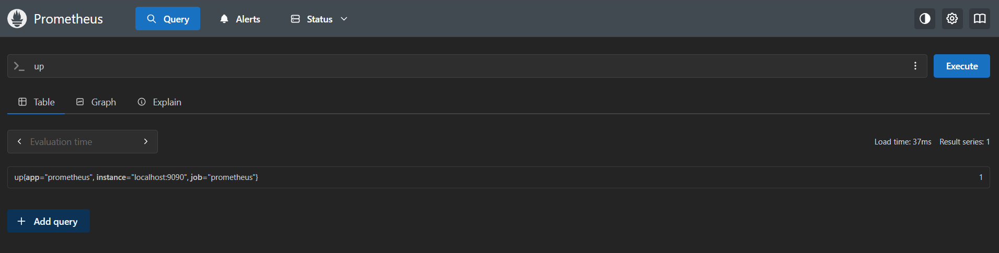

# N3-3A – Cài đặt Prometheus và kiểm tra khả năng truy cập

| Thông tin | Chi tiết |
|---|---|
| Jira Issue | SCRUM-12 |
| Nhóm thực hiện | N3-3A |
| Người thực hiện | Thanh Tuyền |
| Ngày thực hiện | 18/11/2026 |
| Công cụ giám sát | Prometheus 3.16.0 |
| Trạng thái | Đã triển khai và kiểm tra trên máy host |

## 1. Mục tiêu

Cài đặt Prometheus trên máy chủ Ubuntu Server, cấu hình Prometheus chạy dưới dạng systemd service và kiểm tra khả năng truy cập giao diện Web.

Đồng thời thực hiện truy vấn metrics để xác nhận Prometheus hoạt động bình thường.

## 2. Môi trường triển khai

| Thành phần | Thông tin |
|---|---|
| Hệ điều hành máy host | Windows 11 |
| Phần mềm máy ảo | Oracle VirtualBox 7.2.22 |
| Hệ điều hành máy ảo | Ubuntu Server 26.04 LTS |
| Prometheus | 3.16.0 |
| Network Adapter | Bridged Adapter |
| Giao thức truy cập | HTTP |
| Cổng dịch vụ | 9090 |

## 3. Quá trình cài đặt

### 3.1. Chuẩn bị môi trường

- Cài đặt Oracle VirtualBox trên Windows 11.
- Tạo máy ảo Ubuntu Server 26.04 LTS.
- Khởi động và cấu hình hệ điều hành Ubuntu.
- Cài đặt, kích hoạt SSH để quản trị máy ảo từ Windows host.
- Cấu hình Network Adapter ở chế độ Bridged Adapter.

### 3.2. Cài đặt Prometheus

Các bước thực hiện:

1. Tải gói Prometheus phiên bản 3.16.0 dành cho Linux AMD64.
2. Giải nén gói cài đặt.
3. Sao chép hai chương trình `prometheus` và `promtool` vào `/usr/local/bin/`.
4. Tạo system user có tên `prometheus` để chạy dịch vụ.
5. Tạo và sử dụng thư mục cấu hình `/etc/prometheus/`.
6. Sử dụng file cấu hình `/etc/prometheus/prometheus.yml`.
7. Tạo thư mục lưu trữ dữ liệu `/var/lib/prometheus/`.

### 3.3. Cấu hình systemd service

Tạo file dịch vụ:

`/etc/systemd/system/prometheus.service`

Nội dung cấu hình:

```ini
[Unit]
Description=Prometheus Monitoring System
Wants=network-online.target
After=network-online.target

[Service]
User=prometheus
Group=prometheus
Type=simple
ExecStart=/usr/local/bin/prometheus \
    --config.file=/etc/prometheus/prometheus.yml \
    --storage.tsdb.path=/var/lib/prometheus/ \
    --web.listen-address=0.0.0.0:9090

Restart=always

[Install]
WantedBy=multi-user.target
```

Sau khi tạo file cấu hình, thực hiện nạp lại cấu hình systemd, bật dịch vụ khởi động cùng hệ thống và khởi chạy Prometheus:

```bash
sudo systemctl daemon-reload
sudo systemctl enable prometheus
sudo systemctl start prometheus
```

## 4. Kiểm tra hoạt động

### 4.1. Kiểm tra trạng thái dịch vụ

Sử dụng lệnh:

```bash
sudo systemctl status prometheus --no-pager
```

**Kết quả thực tế:** Dịch vụ Prometheus hoạt động với trạng thái `active (running)`.



### 4.2. Kiểm tra cổng dịch vụ

Sử dụng lệnh:

```bash
ss -lntp | grep 9090
```

**Kết quả thực tế:** Prometheus đang lắng nghe trên cổng TCP 9090.

### 4.3. Kiểm tra giao diện Web

Truy cập địa chỉ sau từ trình duyệt trên Windows host:

`http://<IP-máy-ảo>:9090`

**Kết quả thực tế:** Giao diện Prometheus Web UI hiển thị thành công.



### 4.4. Kiểm tra truy vấn metrics

Tại giao diện Prometheus, thực hiện truy vấn PromQL:

```promql
up
```

**Kết quả thực tế:** Truy vấn trả về giá trị `1` cho target Prometheus với các thông tin:

- `job="prometheus"`
- `instance="localhost:9090"`

Giá trị `1` cho biết target đang được Prometheus thu thập metrics thành công tại thời điểm kiểm tra.



## 5. Tổng kết kết quả

| STT | Hạng mục kiểm tra | Kết quả |
|---:|---|---|
| 1 | Cài đặt Prometheus 3.16.0 | Thành công |
| 2 | Cấu hình systemd service | Thành công |
| 3 | Thiết lập tự khởi động cùng hệ thống | Thành công |
| 4 | Trạng thái dịch vụ `active (running)` | Đạt |
| 5 | Cổng TCP 9090 đang lắng nghe | Đạt |
| 6 | Truy cập Web UI từ Windows host | Đạt |
| 7 | Truy vấn `up` trả về giá trị `1` | Đạt |
| 8 | Truy cập từ máy tính thành viên khác trong LAN | Chưa xác nhận |

**Lưu ý về kết nối mạng:** Việc truy cập Prometheus từ máy tính thành viên khác trong cùng mạng LAN chưa được xác nhận. Khi kiểm tra từ máy của thành viên khác, lệnh ping trả về `Destination host unreachable`. Phần kiểm tra kết nối giữa các máy hiện được tạm gác và cần tiếp tục nếu có yêu cầu.

## 6. Các đường dẫn quan trọng

| Thành phần | Đường dẫn |
|---|---|
| Prometheus binary | `/usr/local/bin/prometheus` |
| Promtool binary | `/usr/local/bin/promtool` |
| File cấu hình | `/etc/prometheus/prometheus.yml` |
| Thư mục lưu dữ liệu | `/var/lib/prometheus/` |
| Systemd service | `/etc/systemd/system/prometheus.service` |

## 7. Các lệnh quản trị thường dùng

**Kiểm tra trạng thái:**

```bash
sudo systemctl status prometheus
```

**Khởi động dịch vụ:**

```bash
sudo systemctl start prometheus
```

**Dừng dịch vụ:**

```bash
sudo systemctl stop prometheus
```

**Khởi động lại dịch vụ:**

```bash
sudo systemctl restart prometheus
```

**Theo dõi log:**

```bash
sudo journalctl -u prometheus -f
```

## 8. Minh chứng

Các ảnh minh chứng được lưu trong thư mục `monitoring/evidence/` của repository:

| Tên file | Nội dung |
|---|---|
| `prometheus-ui.png` | Giao diện Prometheus Web UI |
| `prometheus-query-up.png` | Kết quả truy vấn metrics `up` |
| `prometheus-active.png` | Trạng thái systemd service |

## 9. Kết luận

Đã hoàn thành việc cài đặt Prometheus 3.16.0 trên Ubuntu Server 26.04 LTS, cấu hình dịch vụ systemd và kiểm tra hoạt động cơ bản.

Prometheus có thể khởi động cùng hệ thống, lắng nghe trên cổng 9090, truy cập giao diện Web từ Windows host và trả về kết quả `1` khi thực hiện truy vấn `up`.

Kết quả triển khai được ghi nhận để phục vụ Jira Issue **SCRUM-12** trong dự án HKDN Monitoring.