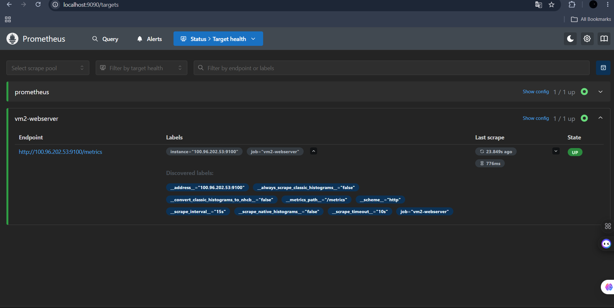
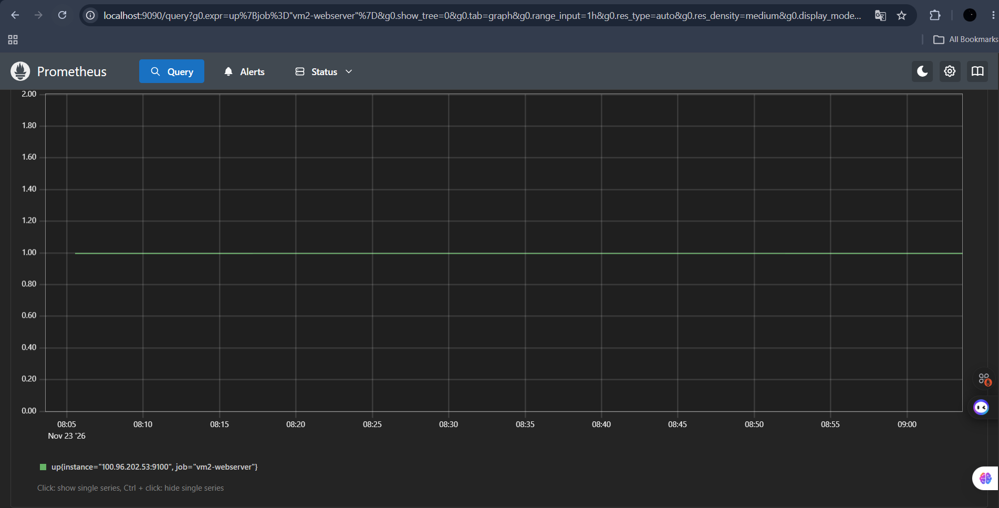
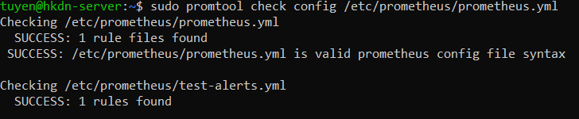
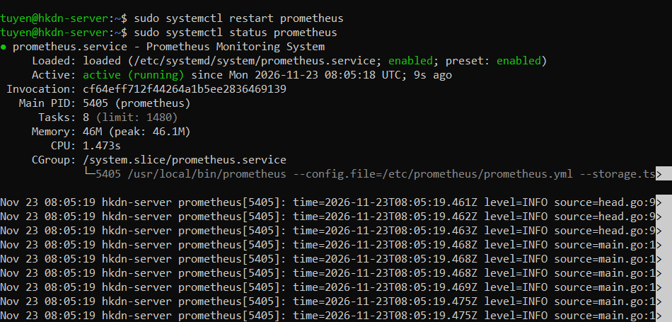
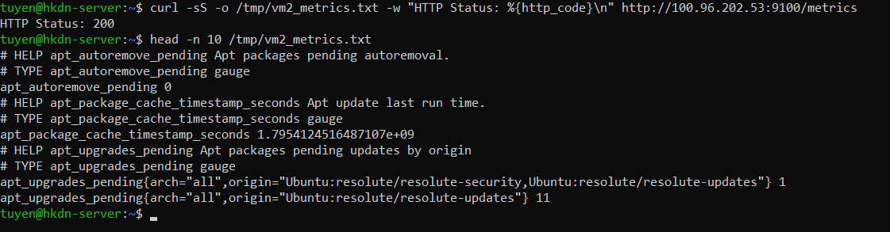

# SCRUM-30 – Cấu hình Prometheus giám sát VM2 Webserver

## 1. Mục tiêu

Cấu hình Prometheus trên Monitoring Server để thu thập dữ liệu giám sát (metrics) từ VM2 Webserver thông qua Node Exporter.

Sau khi cấu hình, tiến hành kiểm tra kết nối, xác thực cấu hình Prometheus, kiểm tra trạng thái Target và truy vấn dữ liệu nhằm xác nhận VM2 đã được tích hợp thành công vào hệ thống Monitoring.

## 2. Môi trường triển khai

| Thành phần | Thông tin |
|---|---|
| Monitoring Server | Ubuntu – `hkdn-server` |
| Công cụ giám sát | Prometheus |
| Máy được giám sát | VM2 Webserver |
| Exporter | Node Exporter |
| Kết nối mạng | Tailscale |
| IP Tailscale của VM2 | `100.96.202.53` |
| Cổng Node Exporter | `9100` |
| Endpoint Metrics | `http://100.96.202.53:9100/metrics` |
| Job Name | `vm2-webserver` |
| Scrape Interval | `15s` |

## 3. Kiểm tra Node Exporter và kết nối VM2

Node Exporter đã được cài đặt và hoạt động trên VM2 Webserver.

Tiến hành kiểm tra khả năng truy cập endpoint metrics từ Monitoring Server bằng lệnh:

```bash
curl -sS -o /tmp/vm2_metrics.txt -w "HTTP Status: %{http_code}\n" http://100.96.202.53:9100/metrics
```

**Kết quả:** Endpoint Node Exporter trả về HTTP Status `200`, xác nhận Monitoring Server có thể truy cập và lấy dữ liệu metrics từ VM2.

## 4. Cấu hình Prometheus

### 4.1. Sao lưu cấu hình

Trước khi chỉnh sửa cấu hình Prometheus, tiến hành sao lưu file cấu hình hiện tại:

```bash
sudo cp /etc/prometheus/prometheus.yml /etc/prometheus/prometheus.yml.bak-week4
```

File sao lưu được tạo thành công tại:

```text
/etc/prometheus/prometheus.yml.bak-week4
```

### 4.2. Thêm cấu hình scrape VM2

Thêm job `vm2-webserver` vào file cấu hình:

```text
/etc/prometheus/prometheus.yml
```

Nội dung cấu hình:

```yaml
  - job_name: "vm2-webserver"
    static_configs:
      - targets: ["100.96.202.53:9100"]
```

Cấu hình sử dụng địa chỉ Tailscale của VM2 và cổng Node Exporter `9100` làm target thu thập metrics.

Scrape Interval của Prometheus được cấu hình ở mức `15s`.

## 5. Kiểm tra cấu hình Prometheus

Sau khi cập nhật cấu hình, tiến hành kiểm tra cú pháp và tính hợp lệ bằng `promtool`:

```bash
sudo promtool check config /etc/prometheus/prometheus.yml
```

**Kết quả:** Prometheus configuration hợp lệ, kiểm tra thành công. Các rule hiện có cũng được nhận diện trong quá trình kiểm tra.

## 6. Khởi động lại Prometheus

Sau khi xác nhận cấu hình hợp lệ, khởi động lại Prometheus để áp dụng cấu hình mới:

```bash
sudo systemctl restart prometheus
```

Kiểm tra trạng thái service:

```bash
sudo systemctl status prometheus
```

**Kết quả:** Prometheus hoạt động ở trạng thái `active (running)`.

## 7. Kiểm tra Target trên Prometheus

Truy cập giao diện Prometheus Targets để kiểm tra trạng thái scrape của các target.

Target mới được cấu hình:

| Thuộc tính | Giá trị |
|---|---|
| Job | `vm2-webserver` |
| Endpoint | `100.96.202.53:9100` |
| Scrape Interval | `15s` |
| Scrape Timeout | `10s` |
| Health | `UP` |

**Kết quả kiểm tra:** Target `vm2-webserver` hiển thị trạng thái `UP`, số target hoạt động là `1/1 up`. Prometheus đã thu thập metrics từ VM2 Webserver thành công.

## 8. Kiểm tra dữ liệu bằng PromQL

Tiến hành truy vấn trạng thái hoạt động của target VM2:

```promql
up{job="vm2-webserver"}
```

Có thể kiểm tra kết quả thông qua Prometheus API bằng lệnh:

```bash
curl -s 'http://localhost:9090/api/v1/query?query=up%7Bjob%3D%22vm2-webserver%22%7D'
```

**Kết quả:** API trả về trạng thái truy vấn thành công, target `100.96.202.53:9100` thuộc job `vm2-webserver` có giá trị `1`.

Ý nghĩa:

- `1`: Target đang hoạt động và Prometheus scrape thành công.
- `0`: Target không hoạt động hoặc scrape thất bại.

Kết quả `1` xác nhận VM2 Webserver đang được Prometheus giám sát bình thường.

## 9. Kết quả thực hiện

Các công việc thuộc SCRUM-30 đã hoàn thành:

- [x] Cấu hình Prometheus scrape VM2 Webserver.
- [x] Sử dụng Tailscale IP để kết nối đến VM2.
- [x] Cấu hình Node Exporter target tại cổng `9100`.
- [x] Sao lưu file cấu hình Prometheus trước khi chỉnh sửa.
- [x] Kiểm tra cấu hình bằng `promtool`.
- [x] Khởi động lại Prometheus và xác nhận service hoạt động.
- [x] Kiểm tra target `vm2-webserver` trên Prometheus UI.
- [x] Xác nhận target có trạng thái `UP`.
- [x] Kiểm tra dữ liệu bằng PromQL.
- [x] Xác nhận kết quả `up = 1`.
- [x] Ghi nhận cấu hình và kết quả tích hợp.

## 10. Kết luận

VM2 Webserver đã được tích hợp thành công vào hệ thống Prometheus Monitoring.

Prometheus có thể truy cập Node Exporter thông qua Tailscale, thu thập metrics từ VM2 và hiển thị target `vm2-webserver` ở trạng thái `UP`.

Kết quả kiểm tra trên Prometheus UI và truy vấn PromQL đều xác nhận VM2 hoạt động bình thường trong hệ thống giám sát.

SCRUM-30 đã hoàn thành về mặt kỹ thuật.

## 11. Bằng chứng thực hiện (Evidence)

Các hình ảnh dưới đây ghi nhận quá trình cấu hình, kiểm tra và xác minh việc tích hợp VM2 Webserver vào Prometheus Monitoring.

### Evidence 1 – Prometheus Targets

**File:** `prometheus-targets-vm2.png`

Xác nhận Target `vm2-webserver` đã được Prometheus phát hiện và đang hoạt động với trạng thái `UP`, đạt `1/1 up`.



### Evidence 2 – Prometheus Query

**File:** `prometheus-query-vm2.png`

Xác nhận truy vấn `up{job="vm2-webserver"}` trả về giá trị `1`, chứng minh Prometheus thu thập dữ liệu từ VM2 thành công.



### Evidence 3 – Kiểm tra cấu hình Prometheus

**File:** `promtool-check.png`

Ghi nhận kết quả kiểm tra cấu hình bằng `promtool check config`, xác nhận cấu hình Prometheus hợp lệ.



### Evidence 4 – Trạng thái Prometheus Service

**File:** `prometheus-service-status.png`

Ghi nhận trạng thái dịch vụ Prometheus sau khi cập nhật cấu hình và khởi động lại, xác nhận service đang hoạt động.



### Evidence 5 – Node Exporter HTTP Endpoint

**File:** `node-exporter-http.png`

Ghi nhận kết quả kiểm tra endpoint Node Exporter trên VM2, xác nhận endpoint có thể truy cập và trả về HTTP Status `200`.



---

## 12. Các thành phần bổ sung trong Tuần 4

Ngoài việc tích hợp VM2 Webserver, trong Tuần 4 hệ thống Monitoring Server tiếp tục được bổ sung và cấu hình các thành phần phục vụ Alerting.

### 12.1. Alertmanager

- Cài đặt và cấu hình Alertmanager trên Monitoring Server Ubuntu.
- Alertmanager sử dụng endpoint local: `127.0.0.1:9093`.
- Cập nhật cấu hình Prometheus để kết nối Alertmanager tại endpoint trên.
- Kiểm tra cấu hình Prometheus bằng `promtool check config` trước khi áp dụng.

Cấu hình kết nối Alertmanager trong `/etc/prometheus/prometheus.yml`:

```yaml
alerting:
  alertmanagers:
    - static_configs:
        - targets:
            - "127.0.0.1:9093"
```

### 12.2. Khắc phục DNS để Alertmanager gửi thông báo

Trong quá trình kiểm tra gửi cảnh báo Telegram, server gặp lỗi phân giải DNS. DNS resolver `192.168.100.1` không phản hồi truy vấn DNS. Đã kiểm tra kết nối mạng và xác định server vẫn truy cập Internet qua gateway.

Đã sao lưu cấu hình Netplan và cập nhật DNS của interface `enp0s3` sang:

- `1.1.1.1`
- `8.8.8.8`

Cấu hình được áp dụng bằng Netplan. Sau thay đổi, kiểm tra phân giải tên miền `api.telegram.org` và kết nối HTTPS đến Telegram API đều thành công. Thử gửi cảnh báo Telegram cũng nhận thành công.

### 12.3. Đồng bộ thời gian – vấn đề cần tiếp tục theo dõi

Server từng gặp hiện tượng sai lệch thời gian. Đã xử lý đồng bộ nhưng tình trạng tái xuất hiện sau khi tắt và khởi động lại máy. Nguyên nhân chưa được xác định; cần tiếp tục kiểm tra NTP/time synchronization và tính ổn định sau reboot.

### 12.4. Tổng hợp thành phần và cấu hình bổ sung trong Tuần 4

| Thành phần / cấu hình | Nội dung | Trạng thái |
|---|---|---|
| Prometheus | Scrape metrics VM2 qua Node Exporter | Hoạt động, target UP |
| Node Exporter | Endpoint VM2 tại port 9100 | Endpoint trả HTTP 200 |
| Alertmanager | Cài đặt và cấu hình trên Monitoring Server | Đã cấu hình |
| Prometheus–Alertmanager | Kết nối qua `127.0.0.1:9093` | Đã cấu hình |
| DNS Netplan | Đổi DNS enp0s3 sang 1.1.1.1 và 8.8.8.8 | Áp dụng, kiểm tra DNS/HTTPS thành công |
| Time synchronization | Theo dõi đồng bộ thời gian sau reboot | Còn cần kiểm tra |
