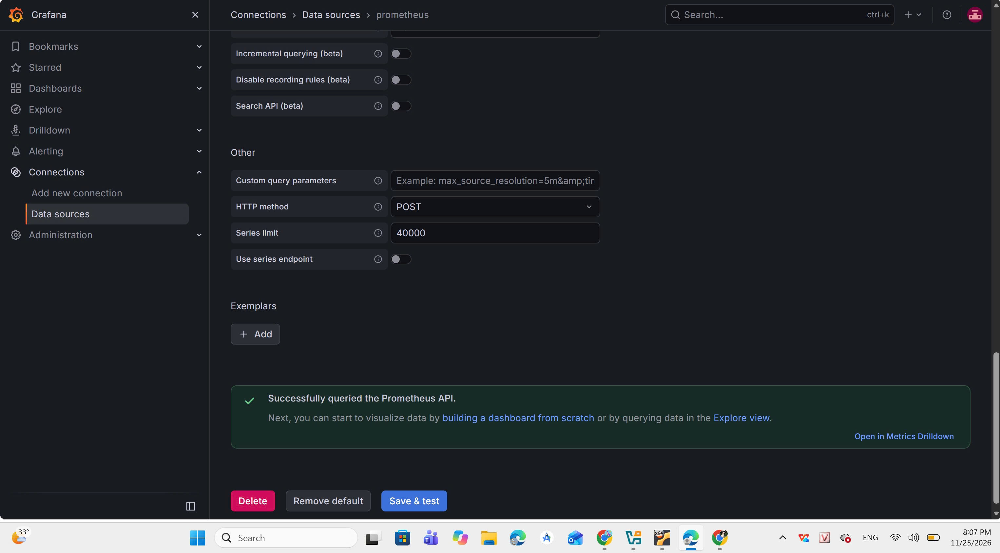
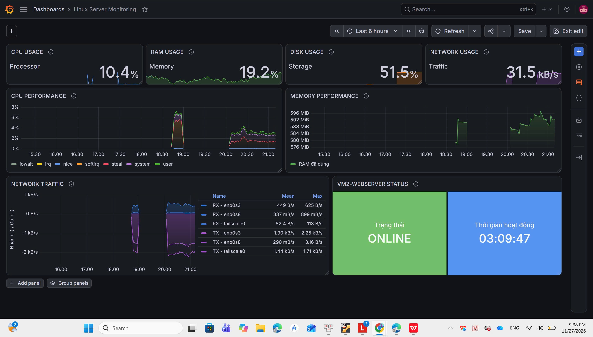
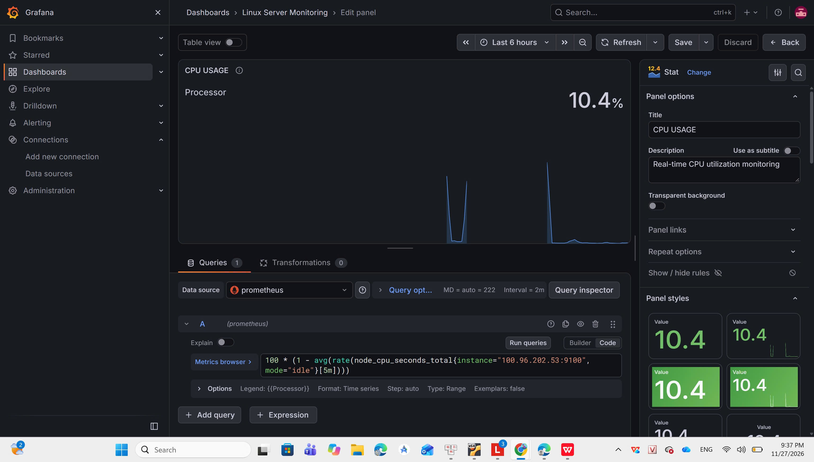
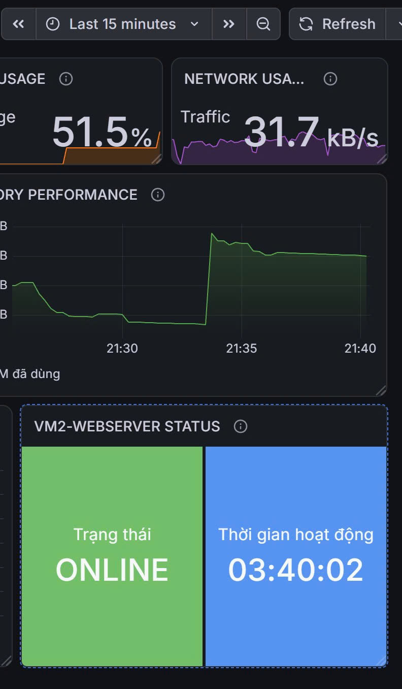
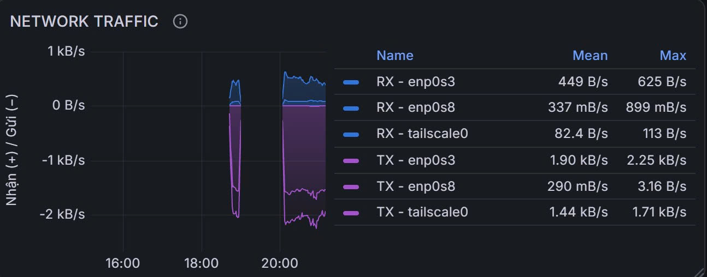
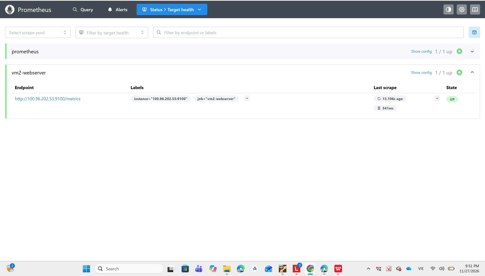
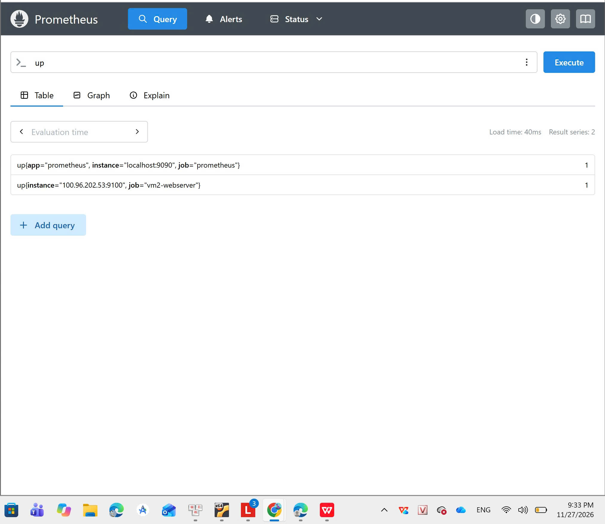

# SCRUM-43 – Tích hợp Prometheus và xây dựng Dashboard Grafana

| Thông tin | Chi tiết |
|---|---|
| Jira Issue | SCRUM-43 (thuộc SCRUM-28) |
| Người thực hiện | Ánh Nguyệt |
| Ngày thực hiện | 22/11/2026 – 27/11/2026 |
| Hạn hoàn thành | 28/11/2026 |
| Trạng thái | Hoàn thành |

## 1. Mục tiêu

Kết nối Grafana với Prometheus và xây dựng Dashboard thử nghiệm để hiển thị các metrics thu thập được từ Node Exporter trên VM2 Webserver (job `vm2-webserver`, cấu hình ở SCRUM-30).

**Kết quả cần đạt:** Dashboard thử nghiệm hiển thị đúng metrics từ Prometheus; Data source kết nối thành công và có minh chứng đính kèm.

## 2. Môi trường triển khai

| Thành phần | Thông tin |
|---|---|
| Monitoring Server | Ubuntu – Prometheus + Grafana |
| Grafana | `http://localhost:3000` (cài đặt ở SCRUM-17) |
| Prometheus | `http://localhost:9090` (SCRUM-12) |
| Máy được giám sát | VM2 Webserver |
| Exporter | Node Exporter – `100.96.202.53:9100` (Tailscale) |
| Job Prometheus | `vm2-webserver` (SCRUM-30) |
| Data source Grafana | `prometheus` |
| Dashboard | `Linux Server Monitoring` |

## 3. Kết nối Grafana với Data source Prometheus

Trên Grafana: **Connections → Data sources → prometheus** → kéo xuống cuối trang → **Save & test**.

**Kết quả:** Grafana hiển thị thông báo **"Successfully queried the Prometheus API."** – Data source kết nối Prometheus thành công (Evidence 1).

## 4. Xây dựng Dashboard thử nghiệm

Tạo Dashboard **Linux Server Monitoring** trên Grafana (**Dashboards → New → New dashboard → Add visualization**), chọn Data source `prometheus` cho các panel.

### 4.1. Các panel trên Dashboard

| Hàng | Panel | Loại | Nội dung hiển thị |
|---|---|---|---|
| 1 | CPU USAGE | Stat | % CPU đang dùng (Processor) |
| 1 | RAM USAGE | Stat | % RAM đang dùng (Memory) |
| 1 | DISK USAGE | Stat | % dung lượng đĩa đã dùng (Storage) |
| 1 | NETWORK USAGE | Stat | Lưu lượng mạng hiện tại (Traffic, kB/s) |
| 2 | CPU PERFORMANCE | Time series | CPU theo từng mode: `iowait`, `irq`, `nice`, `softirq`, `steal`, `system`, `user` |
| 2 | MEMORY PERFORMANCE | Time series | RAM đã dùng theo thời gian (MiB) |
| 3 | NETWORK TRAFFIC | Time series + bảng | Nhận (RX, +) / Gửi (TX, −) theo interface `enp0s3`, `enp0s8`, `tailscale0`, kèm giá trị Mean / Max |
| 3 | VM2-WEBSERVER STATUS | Stat | Trạng thái (ONLINE/OFFLINE) và Thời gian hoạt động của VM2 |

### 4.2. Truy vấn PromQL của panel CPU USAGE

```promql
100 * (1 - avg(rate(node_cpu_seconds_total{instance="100.96.202.53:9100", mode="idle"}[5m])))
```

Truy vấn lấy tỉ lệ thời gian CPU ở trạng thái `idle` trong 5 phút gần nhất trên VM2, lấy phần còn lại nhân 100 để ra % CPU đang sử dụng (Evidence 3).

## 5. Kiểm tra dữ liệu hiển thị trên các panel

### 5.1. Kiểm tra phía Prometheus

| Kiểm tra | Kết quả |
|---|---|
| Status → Target health, job `vm2-webserver` | Endpoint `http://100.96.202.53:9100/metrics`, trạng thái **UP**, `1 / 1 up`, last scrape 13.106s, thời gian scrape 341ms (Evidence 6) |
| Query `up` | `up{instance="100.96.202.53:9100", job="vm2-webserver"} = 1` và `up{job="prometheus"} = 1` (Evidence 7) |

### 5.2. Giá trị hiển thị trên Dashboard (27/11/2026, khoảng 21:38, khung thời gian Last 6 hours)

| Panel | Giá trị trên Grafana | Đối chiếu |
|---|---|---|
| VM2-WEBSERVER STATUS – Trạng thái | ONLINE | Khớp với Prometheus: target `vm2-webserver` UP, `up = 1` |
| VM2-WEBSERVER STATUS – Thời gian hoạt động | 03:09:47 (Evidence 2), 03:40:02 (Evidence 4) | Panel có dữ liệu, VM2 đang hoạt động |
| CPU USAGE | 10.4% | Panel truy vấn trực tiếp `node_cpu_seconds_total` của VM2 qua Data source `prometheus` |
| RAM USAGE | 19.2% | MEMORY PERFORMANCE dao động khoảng 576 – 596 MiB |
| DISK USAGE | 51.5% | Ổn định trong các lần chụp |
| NETWORK USAGE | 31.5 kB/s (31.7 kB/s ở lần chụp sau) | NETWORK TRAFFIC có dữ liệu RX/TX của `enp0s3`, `enp0s8`, `tailscale0` |

Số liệu NETWORK TRAFFIC (Last 6 hours):

| Interface | Mean | Max |
|---|---|---|
| RX - enp0s3 | 449 B/s | 625 B/s |
| RX - enp0s8 | 337 mB/s | 899 mB/s |
| RX - tailscale0 | 82.4 B/s | 113 B/s |
| TX - enp0s3 | 1.90 kB/s | 2.25 kB/s |
| TX - enp0s8 | 290 mB/s | 3.16 B/s |
| TX - tailscale0 | 1.44 kB/s | 1.71 kB/s |

Các khoảng trống trên biểu đồ CPU, Memory và Network là các khoảng thời gian Prometheus không có dữ liệu scrape từ VM2.

## 6. Kết quả thực hiện

- [x] Data source Prometheus kết nối thành công (Save & test).
- [x] Tạo Dashboard `Linux Server Monitoring` với 8 panel.
- [x] Panel trạng thái VM2 hiển thị `ONLINE` và thời gian hoạt động.
- [x] Panel CPU, RAM, Disk, Network hiển thị dữ liệu của VM2.
- [x] Trạng thái trên Dashboard khớp với Prometheus (target `vm2-webserver` UP, `up = 1`).
- [x] Ghi nhận ảnh minh chứng.

## 7. Kết luận

Grafana đã kết nối thành công với Prometheus thông qua Data source `prometheus`. Dashboard **Linux Server Monitoring** hiển thị đầy đủ các metrics CPU, RAM, Disk, Network và trạng thái hoạt động của VM2 Webserver được Prometheus thu thập từ Node Exporter. Trạng thái `ONLINE` trên Dashboard khớp với target `vm2-webserver` ở trạng thái `UP` và giá trị `up = 1` trên Prometheus.

SCRUM-43 đã hoàn thành về mặt kỹ thuật.

## 8. Bằng chứng thực hiện (Evidence)

### Evidence 1 – Data source Prometheus

**File:** `grafana-datasource-prometheus.jpg`

Save & test Data source `prometheus` thành công: "Successfully queried the Prometheus API."



### Evidence 2 – Dashboard Linux Server Monitoring

**File:** `grafana-dashboard-vm2.jpg`

Toàn bộ Dashboard với 8 panel có dữ liệu của VM2.



### Evidence 3 – Truy vấn panel CPU USAGE

**File:** `grafana-panel-cpu-query.jpg`

Màn hình chỉnh sửa panel CPU USAGE: Data source `prometheus` và truy vấn PromQL lấy metrics CPU của VM2.



### Evidence 4 – Trạng thái VM2 trên Dashboard

**File:** `grafana-vm2-status.jpg`

Panel VM2-WEBSERVER STATUS hiển thị `ONLINE` và thời gian hoạt động; panel Disk, Network và Memory có dữ liệu.



### Evidence 5 – Network Traffic

**File:** `grafana-network-traffic-vm2.jpg`

Panel NETWORK TRAFFIC với lưu lượng nhận/gửi theo từng interface của VM2.



### Evidence 6 – Prometheus Target health

**File:** `prometheus-targets-dashboard-vm2.jpg`

Target `vm2-webserver` (`http://100.96.202.53:9100/metrics`) ở trạng thái `UP`, `1 / 1 up`.



### Evidence 7 – Prometheus Query `up`

**File:** `prometheus-query-up-vm2.jpg`

Truy vấn `up` trả về giá trị `1` cho cả `prometheus` và `vm2-webserver`.


